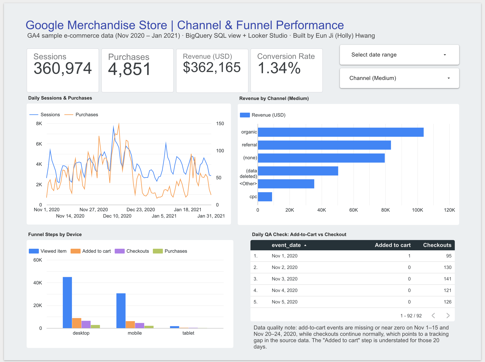
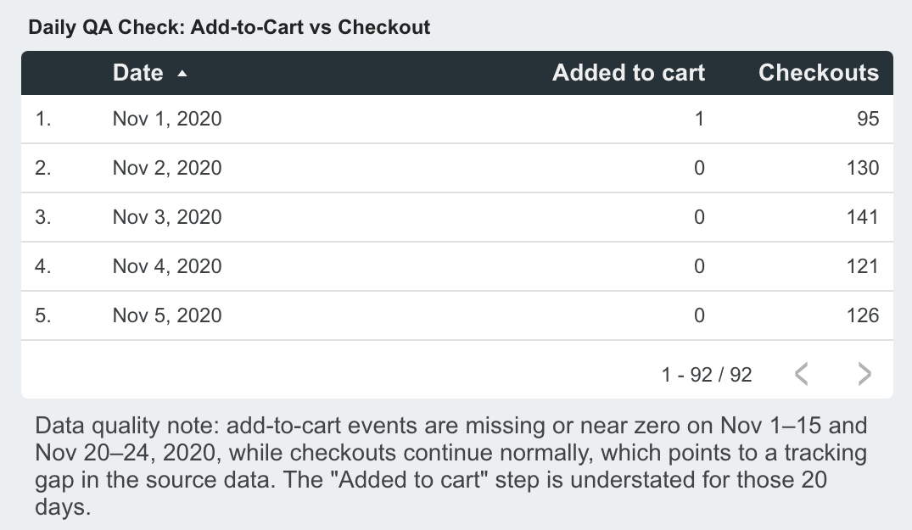

# GA4 Channel & Funnel Dashboard (BigQuery + Looker Studio)

A marketing performance dashboard built on Google's public GA4 e-commerce sample data
(Google Merchandise Store, Nov 2020 to Jan 2021). Raw GA4 events are modelled in a
BigQuery table and SQL views, then reported in Looker Studio with KPI scorecards, a 7-day trend,
a channel table, funnel step rates by device, an automated daily QA check, and a Method, QA &
Definitions page with the audience, data pipeline, KPI definitions, known issues and a change log.

**Live dashboard (public, no sign-in needed):**
<https://datastudio.google.com/reporting/cd440243-4dd2-4a16-b026-54507dded7ab>



*Screenshot is from v1; later changes are listed in the [change log](#change-log).*

---

## Audience and questions

This is a self-directed portfolio project. I designed it for an **account manager
preparing for a client performance call** who needs to answer two questions in under a minute:

1. Which first-user channels and devices drive sessions and revenue?
2. Where does the purchase funnel drop off?

## Data and pipeline

| Layer | Details |
| --- | --- |
| Source | `bigquery-public-data.ga4_obfuscated_sample_ecommerce.events_*` (raw GA4 event export) |
| Date range | 2020-11-01 to 2021-01-31 |
| Model | Table `daily_channel_funnel_tbl` built once from the raw export, exposed through the view `daily_channel_funnel` ([SQL](sql/daily_channel_funnel.sql)); views [`daily_trend`](sql/daily_trend.sql) and [`qa_daily_flags`](sql/qa_daily_flags.sql) read from it |
| Grain | `daily_channel_funnel`: date x channel (medium, source) x device; `daily_trend`: date x channel x device (dense grid); `qa_daily_flags`: date |
| Report | Looker Studio, connected to the three views |

**How the view works**

- A CTE pulls the date, traffic medium/source, device category, event name and purchase
  revenue from each raw event.
- A session ID is built from `user_pseudo_id` + `ga_session_id`, which is unnested from
  `event_params`.
- The outer query counts distinct sessions overall and at each funnel step
  (`view_item`, `add_to_cart`, `begin_checkout`, `purchase`), and sums purchase revenue.
- A `CASE` maps raw mediums to business-friendly channel names (e.g. `(none)` becomes
  "Direct (none)"), so the naming convention lives in the model, not in each chart.
- The result is stored as a table, because the sample never changes. Before this, every chart
  query rescanned about 1 GB of raw events and the 7-day trend took around 30 seconds to load.
  The view keeps its name, so Looker Studio did not need to be reconnected.

**Session counting check.** Sessions are counted per day, so a session that crosses midnight
is counted on both days. Counting distinct sessions over the whole range gives 360,129 instead of
360,974: 845 sessions (0.23%), none spanning more than two days. Purchase sessions: 4,848 vs 4,851.
Conversion rate changes by 0.002 percentage points (1.346% vs 1.344%). This is below my 0.5%
threshold for changing the model, so it is documented as a known limit instead.

**`daily_trend` (window functions)**

- Builds a dense calendar x channel x device grid, so `ROWS BETWEEN 6 PRECEDING AND CURRENT ROW`
  always means exactly 7 calendar days, even for segments with no sessions on some days.
- Stores 7-day rolling **sums** (`SUM(...) OVER w7`) rather than averages. Looker re-aggregates
  them, so the 7-day average (`SUM(sessions_7d) / MAX(days_in_window)`) and 7-day conversion
  rate (`SUM(purchase_sessions_7d) / SUM(sessions_7d)`) stay correct under any channel or
  device filter.
- Checked: total sessions match the base view (360,974), and the rolling sum for Jan 31 equals
  the hand-summed Jan 25-31 total (26,408).

**`qa_daily_flags` (automated QA rule)**

- Flags a day when add-to-cart sessions are lower than checkout sessions, since a checkout
  normally follows an add-to-cart.

## Dashboard components

| Component | Purpose |
| --- | --- |
| Audience and decision lines | Under the title: a self-directed portfolio project designed for an account manager, not commissioned by a real client, and the two questions the page answers |
| KPI scorecards | Sessions (360,974), Purchase sessions (4,851), Revenue ($362,165), Conversion rate (1.34%) |
| Default-view takeaway | One line under the KPIs, for the default view only: Organic search leads revenue; Referral has the highest CVR among non-sample channels |
| Next step | One line under the takeaway: investigate the referral sources and landing pages behind the higher conversion rate, validate tracking quality, and check whether the pattern repeats |
| Daily sessions with 7-day average | Daily sessions (light grey) with the 7-day average (bold blue) on one axis |
| First-user channel performance table | Revenue (bars), conversion rate (heatmap), sessions and purchase sessions per first-user channel |
| Funnel step conversion by device | Session to view, view to cart, cart to checkout, checkout to purchase, overall conversion rate and view to purchase rate, **using clean tracking days only (Nov 26 - Jan 31)** |
| Filters | Date range and first-user channel controls, or click a channel row; the channel filter also applies to the trend chart |
| QA alert | Full-width line under the next step, above the charts: the count of flagged days in the raw GA4 export, the root cause is not confirmed, funnel step rates use Nov 26 onward only, and no missing events were estimated or patched |
| Dates requiring review | The 23 days that break the QA rule, newest first, with sessions with add-to-cart vs sessions with checkout. A note under it says the check is global and not affected by the first-user channel filter |
| Data status lines | Two lines under the title: source (public GA4 export → BigQuery model → Looker Studio), then static sample, period, first-user attribution and funnel window |
| Viewer-time note | Last line of the page: the "Data Last Updated" time below it is added by Looker Studio and is not the date of the source data, which is a static Nov 1, 2020 to Jan 31, 2021 sample (the footer itself cannot be turned off) |
| Method, QA & Definitions page | Audience and decision, data pipeline, KPI definitions, design decisions, QA and limitations, and the change log |

## Design choices

- **Headline first.** KPI cards sit at the top so the main numbers can be read in seconds.
- **One definition per metric.** Conversion Rate is a single calculated field,
  `SUM(purchase_sessions) / SUM(sessions)`, so every chart uses the same definition.
- **Business-friendly names.** Raw fields are renamed (e.g. `add_to_cart_sessions` becomes
  "Added to cart") and revenue is formatted as full USD figures instead of compact numbers.
- **Self-serve filters.** Date and channel controls let readers answer follow-up questions
  without a new request.
- **No dual axis.** The first version plotted sessions and purchases on two axes, which invites
  false comparisons. The trend now shows one measure with its 7-day average on a single axis.
- **Rates, not raw counts, for the funnel.** Counts made tablet invisible next to desktop;
  step rates make devices comparable.
- **Don't chart data you know is broken.** The funnel only uses Nov 26 - Jan 31, the period after
  the last day that fails the QA rule (see below), and the status lines, the note beside the funnel table and the QA alert say so.
- **Data quality is visible.** Known data issues are noted on the page itself (see below).
- **Honest attribution labels.** In the GA4 BigQuery export, `traffic_source.medium` is the channel that
  *first acquired the user*, not the channel of each session. The chart and filter are therefore labelled
  "First-user channel". For a client report, the attribution view should be agreed with the account team first.
- **Transferable method, no extra connectors.** The same approach (one modelled table, one definition per
  metric, an automated QA rule) could be applied to lead-gen, Google Ads, LinkedIn or CRM data. This
  dashboard is not connected to any of those sources; it uses only the public GA4 sample.

## Data quality finding

While checking the funnel against the source data, I found that **add-to-cart events are
missing or near zero on Nov 1-15 and Nov 20-24, 2020, while checkouts continue normally**.
Since a checkout normally follows an add-to-cart, this is unlikely to be real customer behaviour.
It could be a tracking gap, or a limitation of the sample itself: Google notes that this public
GA4 dataset is obfuscated and that its internal consistency may be limited. From the data alone,
the root cause can't be confirmed, so I treat it as an unresolved anomaly.

**Source check.** To rule out an error in my own view, I re-counted the events directly in the raw GA4
export with [`sql/qa_raw_event_check.sql`](sql/qa_raw_event_check.sql) (no view in between):

| Date (2020) | add_to_cart events | begin_checkout events |
| --- | ---: | ---: |
| Nov 1 | 4 | 127 |
| Nov 2–15 | 0 every day | 132–605 per day |
| Nov 16 | 85 | 542 |
| Nov 17 | 535 | 693 |
| Nov 20 | 15 | 318 |
| Nov 21–24 | 0 every day | 166–366 per day |
| Nov 26 | 1,047 | 321 |

The gap is present in the raw export itself, so it is not caused by the view's logic.

I did not patch or estimate the missing values. Instead, the dashboard:

- runs an automated QA rule (`qa_daily_flags`) and lists the failing days in the
  **Dates requiring review** table,
- calculates funnel step rates from clean days only (Nov 26 - Jan 31), and
- carries a **data quality note** on the overview page and on the Method, QA & Definitions page.

**From eyeballing to a rule.** I first spotted 20 days by eye (Nov 1-15, Nov 20-24). The rule
flags **23 of 92 days** (Nov 1-16 and Nov 19-25): it also catches partial days such as Nov 16
(34 add-to-cart vs 163 checkout sessions), Nov 19 (39 vs 126) and Nov 25 (78 vs 227). From
Nov 26 onward add-to-cart sessions are consistently above checkouts.

**Why it matters.** Over all 92 days, desktop cart-to-checkout comes out at 73% (6,402 / 8,818).
On clean days only it is 51% (4,306 / 8,474). Using the full range would have overstated that
step by about 22 points.

In a production setting, I would compare against the GA4 interface, then escalate to the team
that owns conversion tracking with the affected dates, the query that shows the gap and a
screenshot, and let the account team know which conclusions the data can and can't support.



## Repository structure

```text
.
├── README.md
├── sql/
│   ├── daily_channel_funnel.sql   # model table + reporting view: sessions and funnel steps by date x channel x device
│   ├── daily_trend.sql            # 7-day rolling sums (window functions)
│   ├── qa_daily_flags.sql         # automated QA rule: add-to-cart < checkout
│   └── qa_raw_event_check.sql     # source check on the raw GA4 export
├── docs/
│   └── release_checklist.md       # checks to run before sharing the report
└── screenshots/
    ├── dashboard_overview.png
    └── qa_check_tracking_gap.png
```

## Reproduce

1. Open the BigQuery console (the free sandbox works) and create a dataset.
2. Run [`sql/daily_channel_funnel.sql`](sql/daily_channel_funnel.sql), then
   [`sql/daily_trend.sql`](sql/daily_trend.sql) and [`sql/qa_daily_flags.sql`](sql/qa_daily_flags.sql),
   replacing the project and dataset name with your own.
3. In Looker Studio, add a BigQuery data source for each view and build the charts.
4. Note: in the BigQuery sandbox, tables and views expire 60 days after creation. Re-run the
   SQL files before then, or move to the free tier.

## Change log

| Date | Change |
| --- | --- |
| 2026-10-20 | v1 built in Looker Studio and linked in my job application: KPI cards, dual-axis trend, channel bar chart, funnel counts by device, QA table |
| 2026-10-22 | Repository published: README, BigQuery view SQL and screenshots |
| 2026-10-23 | Business-friendly field names; add-to-cart gap confirmed in the raw export |
| 2026-10-23 | v2: channel names in the model; `daily_trend` (window functions) with a 7-day average on one axis; `qa_daily_flags` rule with red rows; channel performance table; funnel step rates on clean days only; channel filter applied across data sources; Notes & definitions page |
| 2026-10-25 | v3: base model materialised as a table, so queries no longer rescan about 1 GB of raw events; cross-midnight session check documented; "First-user channel" used in every label; QA columns named as session counts; alert rewritten to separate confirmed facts from the unconfirmed cause; view-to-purchase rate added to the funnel; data status line; page renamed Executive Overview; [release checklist](docs/release_checklist.md) |
| 2026-10-27 | v4: audience and decision lines under the title; data status split into two lines; default-view takeaway; notes beside the channel and funnel tables; QA alert moved beside the funnel table and now says the root cause is not confirmed; trend date axis shortened so the last label is not cut off; second page rebuilt as Method, QA & Definitions; page navigation moved to top tabs |
| 2026-10-27 | v4.1: note explaining the "Data Last Updated" footer; QA alert moved above the funnel and QA tables so it is visible without scrolling; trend and channel charts shortened to make room; helper text raised from 12 to 13 px and the two interaction hints split by purpose; change log on the dashboard reformatted as version · date · change |
| 2026-10-28 | v4.2: next step line added and QA alert moved above the charts; QA alert names the raw GA4 export and says no missing events were estimated or patched; footer note reworded to say the "Data Last Updated" time is added by Looker Studio and is not the date of the source data; channel table renamed "First-user channel performance", with a "Conversion rate" header and a Purchase sessions column; "self-directed" and "not commissioned by a real client" added to page 1; empty space under the charts removed |

---

*Data: Google's public GA4 obfuscated sample e-commerce dataset. Built by Eun Ji (Holly) Hwang.*
